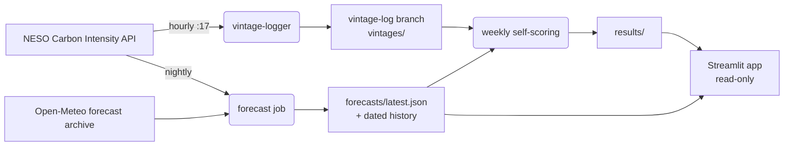

# GB Carbon Intensity Forecast

> **48-hour probabilistic forecasts of Great Britain's grid carbon intensity, evaluated against the grid operator's own forecasts.**

[](https://gb-carbon-forecast-go.streamlit.app/)
[](https://github.com/k-chetan/gb-carbon-forecast/actions/workflows/ci.yml)
[](https://github.com/k-chetan/gb-carbon-forecast/actions/workflows/vintage-logger.yml)
[](https://opensource.org/licenses/MIT)
[](https://www.python.org/downloads/)

## Overview

This project forecasts the carbon intensity (gCO₂/kWh) of the GB national grid 48 hours ahead, with p10/p50/p90 uncertainty bands, using only free public data.

A forecast may only use information that was available at the time it was issued. Weather enters as archived *forecasts* (what a forecaster would have had), never as observations. Comparing against the operator is done carefully: NESO's stored forecast series is revised until shortly before delivery, so it is not a valid 48-hour baseline. Proper comparisons need forecast *vintages*, and because those mostly don't exist for past years, an hourly job here has been capturing NESO's forward forecast since day one. The comparison data grows on its own.

## Architecture



Everything scheduled runs in GitHub Actions and writes versioned files into the repository. The app only reads them, so a failed job means stale data, not wrong data.

## Repository structure

```text
.
├── src/gbcarbon/          # Backend logic
│   ├── neso.py            # -> NESO API client (stdlib only)
│   ├── vintage.py         # -> Hourly fw48h vintage capture
│   ├── watchdog.py        # -> Staleness checks for alerting
│   └── scoring.py         # -> Weekly compaction + prospective scoring
├── tests/                 # Pytest suite + live-API fixtures
├── .github/workflows/     # ci, vintage-logger, watchdog, self-scoring, nightly-forecast
├── docs/decisions.md      # Dated log of design decisions
├── app.py                 # Streamlit entry point
└── Makefile               # Task automation
```

## Operations

All of this runs unattended on GitHub Actions:

- **vintage-logger** (hourly, minute 17): saves NESO's forward 48 h forecast to the `vintage-log` branch. A missed hour is a permanent gap (vintages can't be backfilled) and gets recorded in `vintages/manifest.json`.
- **nightly-forecast** (03:07 UTC): issues the deployed model's 48 h forecast, writing `forecasts/latest.json` plus a dated copy under `forecasts/history/`.
- **watchdog** (daily): opens or updates a **PIPELINE STALE** issue if the last capture is over 6 h old or the last forecast over 48 h old, closes it on recovery, and pushes a keepalive commit if captures ever stop for 7 days (GitHub disables crons after 60 days of repo inactivity).
- **self-scoring** (weekly, Sun): re-scores every matured logged forecast against published actuals from scratch and compacts closed months of the vintage log to parquet. Results go to `results/`.
- **ci** (push/PR): ruff + pytest.

## Live app

👉 **[gb-carbon-forecast-go.streamlit.app](https://gb-carbon-forecast-go.streamlit.app/)** — free-tier apps sleep when idle; the wake button takes ~30 s.

## Quick start

```bash
make setup     # uv sync — creates .venv from the lockfile
make test      # pytest
make run-app   # streamlit run app.py
make report    # regenerate report figures + data and compile build/report.pdf
```

## Pre-submission refresh

One command re-scores everything that has matured since the build and rebuilds the report. Only the prospective sections change; the sealed test results under `results/sealed/` are frozen and never touched:

```bash
make refresh RUN_A=runs/<final-track-A> RUN_B=runs/<final-track-B>
```

This refetches the vintage log, recomputes the weekly scoring summary and the prospective operator comparisons, regenerates the figures, and compiles the PDF. The two run directories to pass are recorded in `results/sealed/sealed_2025.json`.

-----

## License & attribution

**Code:** MIT.

**Data sources:**

- [NESO Carbon Intensity API](https://carbonintensity.org.uk/) — © National Energy System Operator, [CC BY 4.0](https://creativecommons.org/licenses/by/4.0/)
- [Open-Meteo](https://open-meteo.com/) — [CC BY 4.0](https://creativecommons.org/licenses/by/4.0/), non-commercial tier
- [carbon-intensity-forecast-tracking](https://github.com/nmpowell/carbon-intensity-forecast-tracking) (Nick Powell, MIT) — community archive of NESO forecast vintages, used in one part of the operator comparison

> *Disclaimer: this is an independent research project and is not affiliated with NESO or Open-Meteo.*
