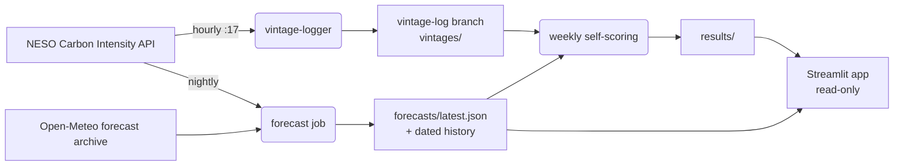

# GB Carbon Intensity Forecast

> **Probabilistic 48-hour forecasts of Great Britain's grid carbon intensity, honestly benchmarked against the grid operator's own forecasts.**

[](https://github.com/k-chetan/gb-carbon-forecast/actions/workflows/ci.yml)
[](https://github.com/k-chetan/gb-carbon-forecast/actions/workflows/vintage-logger.yml)
[](https://opensource.org/licenses/MIT)
[](https://www.python.org/downloads/)

## Overview

This project forecasts the carbon intensity (gCO₂/kWh) of the GB national grid 48 hours ahead with calibrated uncertainty bands (p10/p50/p90), using keyless public data only. Three commitments shape the design:

1. **Issue-time discipline.** A forecast may use only information available at its issue time. Weather enters as archived *forecasts* (what a forecaster had), never as observations (what actually happened).
2. **Honest operator comparison.** NESO's stored forecast series is a near-final, short-horizon product; comparing against it at 48 h would be meaningless. True 48-hour comparisons need forecast *vintages* — so an hourly logger captures NESO's forward forecast as issued, from day one, and the comparison strengthens by itself over time.
3. **A self-running evaluation instrument.** Capture, scoring and alerting run unattended on GitHub Actions; results mature without anyone touching the repo.

## Architecture



Everything scheduled runs in GitHub Actions and writes versioned artifacts into the repository; the app is a read-only consumer, so a job failure can only age what users see, never corrupt it.

## Repository structure

```text
.
├── src/gbcarbon/          # Backend logic
│   ├── neso.py            # -> NESO API client (stdlib only)
│   ├── vintage.py         # -> Hourly fw48h vintage capture
│   ├── watchdog.py        # -> Staleness assessment for alerting
│   └── scoring.py         # -> Weekly compaction + prospective scoring
├── tests/                 # Pytest suite + live-API fixtures
├── .github/workflows/     # ci, vintage-logger, watchdog, self-scoring
├── docs/decisions.md      # One-line log of design decisions
├── app.py                 # Streamlit entry point
└── Makefile               # Task automation
```

## Operations

Everything below runs unattended on GitHub Actions:

- **vintage-logger** (hourly, minute 17): captures NESO's forward 48 h forecast to the `vintage-log` branch. A missed hour is a permanent gap — vintages cannot be backfilled — and is recorded in `vintages/manifest.json`.
- **watchdog** (daily): opens or updates a **PIPELINE STALE** issue when the last capture is over 6 h old or the last nightly forecast over 48 h old, closes it with a comment on recovery, and pushes a keepalive commit if capture activity ever stops for 7 days (GitHub disables crons after 60 days of repo inactivity).
- **self-scoring** (weekly, Sun): compacts closed months of daily vintage CSVs into monthly parquet, re-scores every matured logged forecast against published actuals from scratch (idempotent), and commits `results/prospective_scores.parquet` + `results/prospective_summary.json`.
- **ci** (push/PR): ruff + pytest.

## Quick start

```bash
make setup     # uv sync — creates .venv from the lockfile
make test      # pytest
make run-app   # streamlit run app.py
```

## License & attribution

**Code:** MIT.

**Data sources:**

- [NESO Carbon Intensity API](https://carbonintensity.org.uk/) — © National Energy System Operator, [CC BY 4.0](https://creativecommons.org/licenses/by/4.0/)
- [Open-Meteo](https://open-meteo.com/) — [CC BY 4.0](https://creativecommons.org/licenses/by/4.0/), non-commercial tier

> *Disclaimer: this is an independent research project and is not affiliated with NESO or Open-Meteo.*
